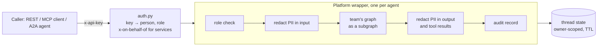

# agentdock

An internal agent platform you can run on a laptop. A team writes one LangGraph graph; the platform adds API-key auth, role checks, PII redaction, a tamper-evident audit log and an eval gate. Every agent is then served over REST, **MCP** and **A2A**.

The idea is from a talk by Workday's agent-platform team: their teams write only the graph, and security, auth and the MCP and A2A endpoints come with the platform. This is a small, working version of that pattern, built on LangChain's open-source Agent Server.

## Measured

| What | Result |
|---|---|
| `dock new` → gate → live server → answered over MCP **and** A2A | **~2.8 s** (3 clean runs: 2.93, 2.78, 2.77 s; `scripts/time_to_prototype.py`) |
| End-to-end HTTP checks against a running server | **10/10** (`scripts/demo.py`) |
| Eval suite, offline scripted model (what CI runs) | **27/27** |
| Eval suite, real model (Gemini 3.5 Flash-Lite, free tier) on the two LLM agents | **18/18** (`evals/results/gemini-*.json`) |
| Unit tests | **32**, ~0.4 s, no keys, no server |

## What a team writes

```
agents/policy_qa/
  agent.toml     name, description, owner team, kind, allowed roles, eval floor
  graph.py       build() -> a LangGraph graph with a `messages` key
  evals.jsonl    cases, each run as a specific person
```

That's all. `dock new my_agent --kind react --team payments` scaffolds all three, and the template passes its own gate as soon as it's created.

## What the platform adds



- **Auth on every route.** `/mcp` and `/a2a` sit behind the same handler as REST. With no key you get a 401. Threads are stamped with their owner, so another user who asks for your thread gets a 404.
- **Delegation, not escalation.** The concierge agent calls other agents over A2A with a service key plus `x-on-behalf-of: <person>`. The callee runs as that person, so going through the concierge never widens access. Only identities with the `delegate` scope may delegate (an employee key that tries gets a 403).
- **Access control in code, not prompts.** `leave_balance` checks the caller itself: employees see their own balance, managers see their direct reports, HR sees everyone. In the real-model run, Gemini *did* try to fetch another employee's balance, and the tool refused.
- **PII redaction both ways.** The wrapper redacts SSNs, IBANs, cards, emails and phone numbers before the agent sees the input. It redacts again on everything the agent produced, including tool results kept in thread state. The team graph runs sealed off: no checkpoints of its own and no streaming out of it, so unredacted intermediate state is never persisted or streamed.
- **Audit log.** One JSON line per run: caller, `via`, tools, redaction counts, latency, denial or error type. Each line hashes the previous one, so `dock audit --verify` catches an edited record.
- **Eval gate.** `dock serve` refuses to start if any agent is below its floor, regresses from `evals/baseline.json`, has too few cases, or has no negative (`not_contains` or `denied`) case. CI runs the same gate.
- **Errors stay inside.** A crashing agent returns "hit an internal error". The traceback goes to the server log and the error type to the audit log.

## Quick start

```bash
uv sync
uv run dock check            # manifests, graphs, eval files; regenerates langgraph.json
uv run dock eval             # runs every case, enforces the gate
uv run dock serve            # gate, then Agent Server on :2024 (needs the .env below)
uv run python scripts/demo.py
uv run dock audit --tail 10
```

`.env` for `dock serve` (A2A between agents over HTTP):

```
AGENTDOCK_A2A_URL=http://127.0.0.1:2024
AGENTDOCK_SERVICE_KEY=dk_dev_svc-concierge
```

Dev API keys are `dk_dev_<identity>`: `dk_dev_e100` (employee), `dk_dev_m200` (manager), `dk_dev_h300` (HR), and so on, for the fake people in `data/directory.json`. Only their SHA-256 hashes are stored (`config/dev_keys.json`). Point `AGENTDOCK_KEYS_FILE` at your own table for anything real.

Use the agents from Claude Code as MCP tools:

```bash
claude mcp add --transport http agentdock http://127.0.0.1:2024/mcp --header "x-api-key: dk_dev_e100"
```

### Models

`AGENTDOCK_MODEL` picks the model for every agent. Teams never choose one.

| Value | Notes |
|---|---|
| `offline` (default) | Each agent's `offline_policy`, a scripted stand-in. Free and deterministic, so CI never needs a key. |
| `gemini:gemini-3.5-flash-lite` | Google's native API (`GEMINI_API_KEY`), free tier. Use `dock eval --pace 8` to stay under rate limits. |
| `cloudflare:@cf/meta/llama-3.3-70b-instruct-fp8-fast` | Workers AI, free daily allowance (`CLOUDFLARE_ACCOUNT_ID`, `CLOUDFLARE_AI_TOKEN`). |

## The agents

| Agent | Kind | Who | What |
|---|---|---|---|
| `policy_qa` | ReAct, 2 tools | employee, manager, HR | HR policy answers and role-checked leave balances |
| `expense_check` | Deterministic workflow, no LLM | employee, manager | Approve, cap, needs receipt, needs manager, or reject |
| `concierge` | ReAct, calls agents over A2A | everyone | Routes to the right specialist, on the caller's behalf |

All data is fake.

## Things that broke while building it

- **MCP calls returned 500 even though the caller was authorized.** The auth handler replaced an empty metadata dict instead of updating it in place. The server kept its own reference, so stateless MCP runs were created without an owner, and the owner filter then hid them from their own caller. There's now a regression test.
- **Concierge → A2A hung forever.** The dev server runs one job at a time by default. The concierge's run took that slot, and the sub-run it was waiting on could never start. `dock serve --jobs` now defaults to 8, and the rule is that slots must exceed the deepest A2A call chain.
- **Blocking I/O on the event loop.** The dev server's detector flagged the synchronous audit-log write, which would stall every concurrent run. It now runs in a worker thread.
- **The first evals only checked the offline model's wording.** On Gemini they failed, even though its answers were correct ("not authorized" vs "may not view"). The cases now check facts and outcomes (numbers, refusals, tools called, secrets absent), and a `contains` entry can list several acceptable phrasings.
- **Subgraph streaming leaked raw PII.** The final responses were clean, but a caller asking for `stream_subgraphs` received the team graph's unredacted state (SSN included) in every stream mode. I'd written "streaming isn't redacted" as a known limit, tested that claim before committing, and found the real hole was wider. The team graph now runs in an isolated context with a config that carries only the caller, and a regression test covers 4 stream modes.
- **Gemini 3 returned 400 on the second tool turn** through the OpenAI-compatible endpoint, because that client drops the `thought_signature` the next turn must echo back. The fix was the native client.

## Limits (not hidden)

- **No token-by-token streaming from inside an agent.** The team graph runs sealed off, and callers only see the wrapper's scrubbed messages. That is the price of the fix below; per-agent opt-in streaming with a streaming-safe redactor is the next step.
- **Tool-call arguments are not redacted**, only message content.
- **Retention TTL is configured** (`checkpointer.ttl` in `langgraph.json`, 30 days in `config/platform.toml`), but I didn't verify the sweeper on the in-memory dev runtime.
- **Only tested on the local dev server.** Not tested on LangSmith Deployment or a self-hosted production Agent Server. The config is standard, but that is unverified.
- **Regex PII detection** catches the formats listed, not names or free-text addresses.
- **The offline policies are scripted**, so a green offline gate proves the plumbing, auth and rules, not model quality. That's what the real-model run is for.

## Layout

```
src/agentdock/   auth, identity, pii, platform (wrapper), audit, evals, models, a2a_client, cli, templates/
agents/          one folder per agent
data/            fake directory and HR records
config/          platform.toml, dev key hashes
scripts/         demo.py (HTTP end-to-end), time_to_prototype.py
tests/           unit tests (no server, no keys)
```
